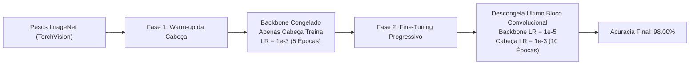

# AgroVision — Classificação de Patologias em Folhas com Deep Learning

Um projeto prático e completo de Visão Computacional e Redes Neurais Convolucionais (CNNs) desenvolvido com PyTorch e TorchVision. O ecossistema abrange desde os fundamentos matemáticos e pipelines de tensores até arquiteturas residuais modernas com **Transfer Learning em 2 Fases**, design orientado a objetos com **Classes Abstratas (ABC)** e um dashboard interativo em **Streamlit**.

---

## 🚀 Destaques de Performance

| Arquitetura | Estratégia | Parâmetros | Acurácia no Teste | Perda (Loss) |
| :--- | :--- | :---: | :---: | :---: |
| **SimpleCNN** | Treinamento do zero (*from scratch*) | ~1.2M | ~80.67% | 0.5120 |
| **MobileNetV3-Small** | Transfer Learning + Fine-Tuning | ~1.5M | **~96.67%** | 0.0890 |
| **ResNet-50** | Transfer Learning + Fine-Tuning (2 Fases) | ~23.5M | **98.00%** | **0.0524** |

---

## 🧠 Arquitetura de Software: Contrato `BaseModel`

Para permitir a troca dinâmica de modelos sem retrabalho nem código acoplado, o projeto adota o princípio de inversão de dependência através de uma classe base abstrata ([base_model.py](file:///home/jos/Desktop/Machine%20Learning/Deep%20Learning/TorchVision/src/deep_learning/models/base_model.py)):

```text
               ┌──────────────────────────────┐
               │    BaseModel (nn.Module, ABC)│
               ├──────────────────────────────┤
               │ + forward(x)                 │
               │ + freeze_gradients()         │
               │ + unfreeze_last_backbone()   │
               └──────────────┬───────────────┘
                              │ (herança)
               ┌──────────────┴───────────────┐
               │                              │
┌──────────────▼──────────────┐ ┌─────────────▼──────────────┐
│  ResNetCustom (ResNet-50)   │ │ MobileNetCustom (MobileNet) │
├─────────────────────────────┤ ├────────────────────────────┤
│ - switch_head()             │ │ - switch_head()            │
│ - get_last_backbone_layer() │ │ - get_last_backbone_layer()│
│ - get_head_parameters()     │ │ - get_head_parameters()    │
└─────────────────────────────┘ └────────────────────────────┘
```

Toda função de treino, validação ou inferência recebe `model: BaseModel`, permitindo plugar novos modelos alterando apenas uma linha de código.

---

## 🔬 Metodologia de Transfer Learning em 2 Fases

Para maximizar a generalização e evitar o esquecimento catastrófico (*catastrophic forgetting*), adotamos o protocolo padrão da indústria:



1. **Fase 1 (Warm-up da Cabeça)**: Congelamento total do backbone (`requires_grad = False`). Somente as camadas lineares recém-adicionadas são otimizadas com taxa de aprendizado rápida (`1e-3`).
2. **Fase 2 (Ajuste Fino Diferencial)**: Descongelamento seletivo da última camada convolucional (`layer4` na ResNet ou `features[-1]` no MobileNet) com taxa conservadora (`1e-5`) combinada à cabeça (`1e-3`).

---

## 🌿 Domínio do Problema: Doenças Foliares

O modelo classifica folhas em três categorias:

* **Saudável (Healthy)**: Tecido vegetal íntegro, sem patógenos aparentes.
* **Oídio (Powdery Mildew)**: Infecção fúngica superficial caracterizada por uma camada esbranquiçada/acinzentada pulverulenta.
* **Ferrugem (Rust)**: Pústulas salientes de tonalidade amarelo-alaranjada a castanho-ferrugem causadas por fungos biotróficos.

### Distribuição do Conjunto de Dados

| Partição | Saudável | Oídio | Ferrugem | Total |
| :--- | :---: | :---: | :---: | :---: |
| **Treino (Train)** | 458 | 430 | 434 | **1.322** |
| **Validação (Validation)** | 20 | 20 | 20 | **60** |
| **Teste (Test)** | 50 | 50 | 50 | **150** |
| **Total Geral** | **528** | **500** | **504** | **1.532** |

---

## 📁 Estrutura do Projeto

```text
.
├── data/                       # Conjuntos de dados particionados (Train, Validation, Test)
├── guide/                      # Trilha técnica em 5 partes sobre TorchVision moderno
│   ├── 01_MODELOS_PRE_TREINADOS_E_TRANSFER_LEARNING.md
│   ├── 02_INGESTAO_DE_DADOS_E_IO.md
│   ├── 03_TRANSFORMS_V2_E_DATA_AUGMENTATION.md
│   ├── 04_INTERPRETABILIDADE_GRADCAM_E_DEPLOY.md
│   └── 05_GUIA_DE_BOLSO_8020.md
├── models/
│   ├── resnet50.pth            # Pesos treinados da ResNet-50 (98% Acc)
│   └── mobile-net.pth          # Pesos treinados da MobileNetV3-Small
├── notebooks/                  # Notebooks experimentais e exploratórios
├── src/
│   ├── deep_learning/
│   │   ├── config.py           # Hiperparâmetros centralizados e caminhos globais
│   │   ├── data/
│   │   │   ├── dataset.py      # DataLoader com pin_memory e paralelismo
│   │   │   └── transforms.py   # Pipelines de pré-processamento e augmentation
│   │   ├── engine/
│   │   │   ├── predictor.py    # Pipeline de inferência desacoplado
│   │   │   └── trainer.py      # Loops de treinamento e validação por época
│   │   └── models/
│   │       ├── base_model.py   # Interface e contrato abstrato BaseModel
│   │       ├── resnet_custom.py# Implementação ResNet-50 com Transfer Learning
│   │       ├── mobilenet_custom.py # Implementação MobileNetV3 com Transfer Learning
│   │       └── simple_cnn.py   # Baseline convolucional inicial
│   ├── ui/
│   │   ├── app.py              # Ponto de entrada da aplicação Streamlit (navegação)
│   │   └── pages/
│   │       ├── home.py         # Visão geral do projeto e patologias
│   │       └── predict_single.py # Diagnóstico com seletor de modelo em tempo real
│   └── main.py                 # Orquestrador do pipeline de treino em 2 fases
├── pyproject.toml              # Dependências e metadados gerenciados via uv
└── README.md
```

---

## ⚙️ Como Executar o Projeto

### 1. Instalação de Dependências
Recomenda-se utilizar o [uv](https://github.com/astral-sh/uv):
```bash
uv sync
```

### 2. Treinar um Modelo
Para treinar a **ResNet-50** ou a **MobileNetV3**, execute o script principal:
```bash
uv run python src/main.py
```

### 3. Iniciar o Dashboard Web (Streamlit)
Execute o servidor Streamlit:
```bash
uv run streamlit run src/ui/app.py
```
Acesse no navegador: **`http://localhost:8501`**

---

## 🖥️ Funcionalidades da Interface

* **Seletor de Arquitetura**: Alterne diretamente na barra lateral entre **ResNet-50** (máxima assertividade) e **MobileNetV3-Small** (alta velocidade).
* **Diagnóstico Interativo**:
  * **Upload de Imagem**: Suporte a formatos JPG, JPEG e PNG (até 10 MB).
  * **Galeria de Amostras de Teste**: Seleção direta das imagens de teste rotuladas.
  * **Carregamento Otimizado**: Pesos mantidos em memória via `@st.cache_resource`.
  * **Relatório Agronômico**: Distribuição gráfica de probabilidades por classe e plano de ação imediato com recomendações agronômicas específicas.
